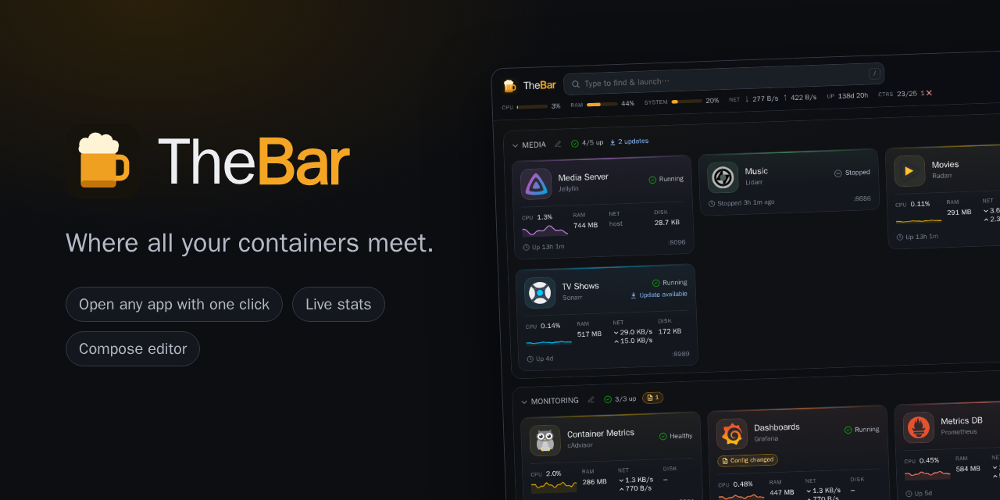
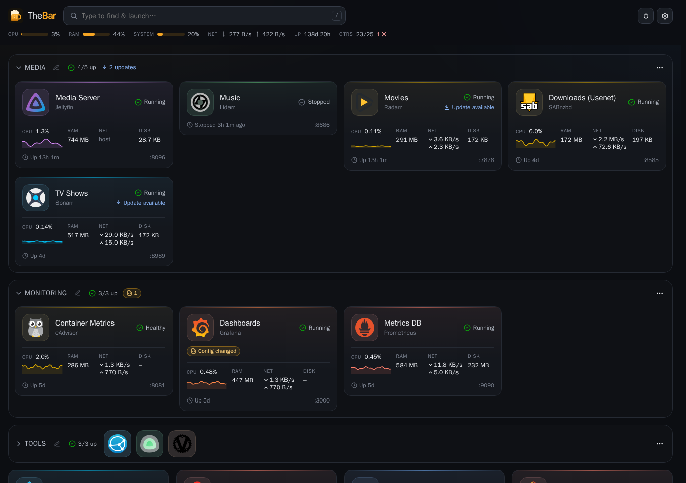
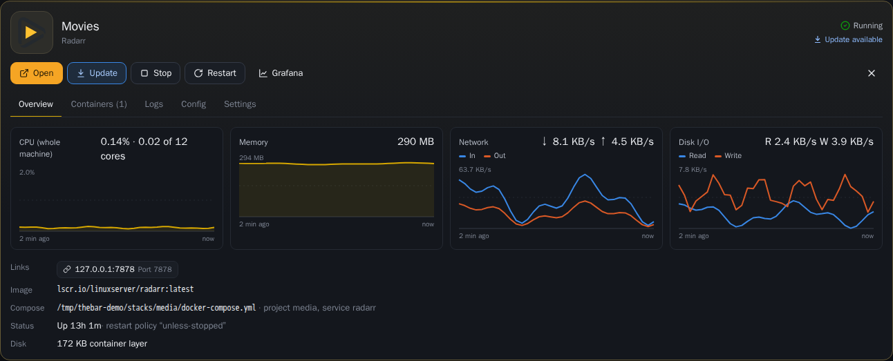
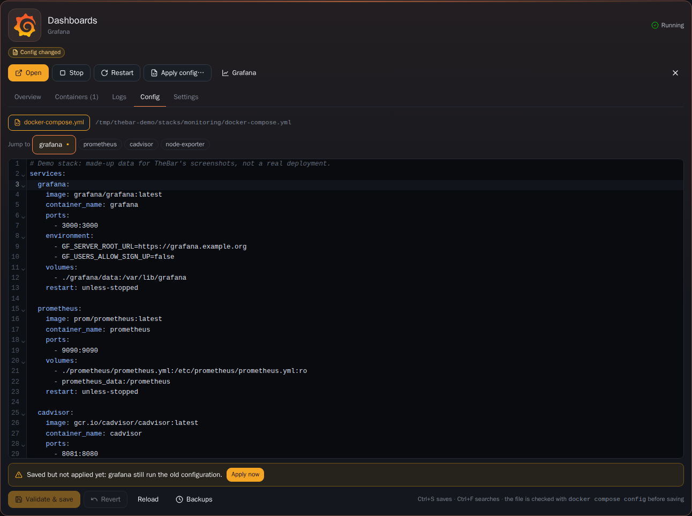
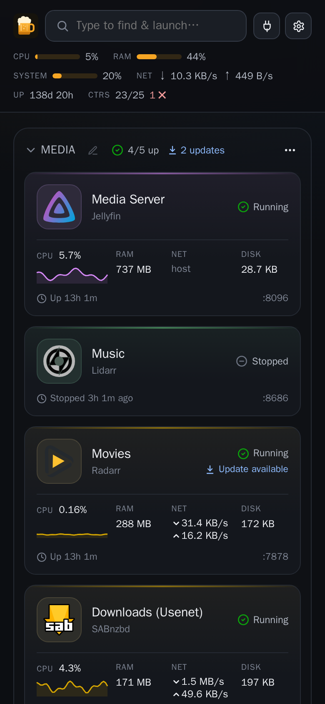

# 

Where all your containers meet. A fast, simple overview of the Docker services on a homelab host: one card per app, click the logo to open its web UI, with live stats and the usual container controls under the hood.



- **Bookmarks first.** Every app with a web UI gets a card; click the logo to open it in a new tab. Links are detected from published ports, host networking and Nginx Proxy Manager domains, and can be overridden per card.
- **Nicknames.** "Movies" instead of "radarr". Common apps get a suggestion, every card can be renamed, and the real name stays underneath.
- **Groups.** Compose projects become collapsible groups automatically. Helpers (databases, caches, exporters) fold into the card of the app they belong to. Similar one-off containers (`name-2024-01-01`, …) collapse into a single card. Arrange everything like a phone home screen: drag a card onto another to make a group, into a group to add it, or between cards to reorder (long-press on touch). Groups move by their header, rename with the pencil, and disappear when empty.
- **Live stats.** Status, health, uptime, CPU, RAM, network, disk, with sparklines on the card and charts in the detail view.
- **Controls.** Start, stop, restart (per card, per container or per stack), live logs.
- **Config editor.** Edit a stack's `docker-compose.yml` and `.env` in the browser. Every save is validated with `docker compose config` and backed up first. TheBar shows which services still run the old config, and "Apply" recreates exactly those.
- **Type to launch.** Start typing anywhere, then press Enter to open the top match.
- **Update badges.** Shows when the registry has a newer image, or when a newer image was pulled but the container wasn't recreated. One click runs pull & recreate.
- **Problem detection.** Restart loops, OOM kills, crashes and unhealthy containers turn the card red with the reason.
- **Host strip.** CPU, RAM, disks, network, uptime and container count.
- **Ports.** Lists what's listening on the host and finds a free port for the next service.
- **Grafana links.** Each card links to Grafana for the container (configurable template).

## Screenshots

Made-up demo data, taken with the tools in `tools/screenshots`.

**An open card:** live charts, start/stop/restart, logs, config.



**The compose editor:** validated before saving, with a prompt to apply the change.



**On a phone:**



## Running it

```sh
git clone https://github.com/RufftaMan/TheBar.git && cd TheBar
cp .env.example .env                    # optional: adjust the listen address, disks…
docker compose up -d --build
```

Open `http://<ip of your server>:8800`. The first time, TheBar asks you to **choose a password**; that's the whole setup.

- First-time setup only works from your local network, with TheBar opened directly by its IP address (or a name like `server.local`), not through a reverse proxy. That keeps strangers from claiming a fresh install. Another name can be allowed with `THEBAR_ALLOWED_HOSTS`.
- Change the password later in **Settings**. Doing so logs out all other devices.
- Forgot it? On the server: `docker exec -it thebar thebar passwd`. This also works instead of the web setup.
- Prefer a config file? Set `THEBAR_PASSWORD` in `.env`; the settings page then shows it as managed there.

### Mounts

TheBar runs with host networking and needs:

| Mount | Why |
|---|---|
| `/var/run/docker.sock` | Docker API |
| `./data:/data` | layout, password hash, session key, icon cache, compose backups |
| your compose files, **at the same path** as on the host | config editor, stack actions. Same path so relative paths inside compose files keep working |
| disks (read-only) | only for the usage bars in the header |

`docker-compose.yml` mounts `/opt`, where many people keep their stacks. Compose projects elsewhere, and your disks, go into `docker-compose.override.yml`: copy [docker-compose.override.example.yml](docker-compose.override.example.yml) and edit it. Docker Compose merges it in automatically, and git ignores it.

### Settings (`.env`)

| Variable | Default | |
|---|---|---|
| `THEBAR_LISTEN` | `0.0.0.0:8800` | `0.0.0.0` means IPv4 only. Use a LAN IP to bind to one interface |
| `THEBAR_DISKS` | `System=/opt` | `Label=/path,…` for the header. A trailing `?` (`USB=/mnt/usb?`) hides the bar while nothing is mounted there |
| `THEBAR_PASSWORD` | – | set the password here instead of in the browser (plain text; then it can't be changed in the app) |
| `THEBAR_ALLOWED_HOSTS` | – | extra host names accepted during first-time setup |
| `THEBAR_AUTH` | – | `off` disables the login. Don't |
| `THEBAR_NPM_DIR` | auto | Nginx Proxy Manager's `nginx/proxy_host` folder |

Per-container labels also work: `thebar.icon=<dashboard-icons slug or URL>`.

## Security

**TheBar has the keys to your host.** It can start, stop and recreate every container, and edit compose files; with access to the Docker socket, that is as good as root on the machine. Treat the password accordingly, and keep TheBar on your local network. Don't expose it to the internet, not even behind its password. If you want remote access, use a VPN such as WireGuard or Tailscale, or put it behind something that does real authentication, plus HTTPS.

What's in place:

- One shared password, stored as a bcrypt hash (`data/password.hash`, readable only by root). Login attempts are limited per client.
- Sessions are signed cookies (`HttpOnly`, `SameSite=Lax`, `Secure` when served over HTTPS, 30 days). Changing the password invalidates all of them.
- Every state-changing request needs a custom header and is refused when the browser flags it as cross-site (CSRF). A strict Content-Security-Policy allows only TheBar's own scripts.
- First-time setup is limited to direct connections from the local network (see above).
- The container runs as root, because it needs the Docker socket and has to write compose files owned by root. It doesn't expose any other service, and it makes no outbound calls other than to the Docker socket, the logo CDN (jsDelivr) and your registries (for update checks).

Not covered: a single shared password (no users or roles), no two-factor login. If you need those, put TheBar behind a reverse proxy with SSO. Found a vulnerability? Please read [SECURITY.md](SECURITY.md).

## How it works

- `backend/` is a single Go binary with the frontend embedded. It talks to the Docker Engine API over the socket, follows the event stream for instant updates, polls stats every 3 s, and pushes everything to the browser over one Server-Sent Events connection. The first page load already contains all data (as an embedded JSON block).
- `frontend/` is Svelte 5 + Vite. The main bundle is about 47 KB gzipped; the code editor (CodeMirror) and drag & drop load only when needed.
- Logos come from [dashboard-icons](https://github.com/homarr-labs/dashboard-icons) (cached locally), falling back to the app's own favicon, then to a monogram. Card accent colours are picked from the logo.
- The layout (order, groups, nicknames, …) is saved on the server, so every browser sees the same thing.

## Development

TheBar can run against a **fake Docker host** with made-up services: handy for trying the interface without a Docker setup, for hacking on the UI, and for the screenshots. It never touches the real Docker.

```sh
cd backend && go run ./cmd/fakedocker   # prints the command that starts TheBar against it
tools/screenshots/run.sh                # rebuilds docs/screenshots (needs go, npm and docker)
```

```sh
# backend on :18800 with auth off
cd frontend && npm ci && npm run build
cd ../backend && THEBAR_AUTH=off THEBAR_DATA=/tmp/thebar THEBAR_LISTEN=127.0.0.1:18800 go run .
# frontend with hot reload (proxies /api and /icons to :18800)
cd frontend && npm run dev
```

## License

[MIT](LICENSE)
